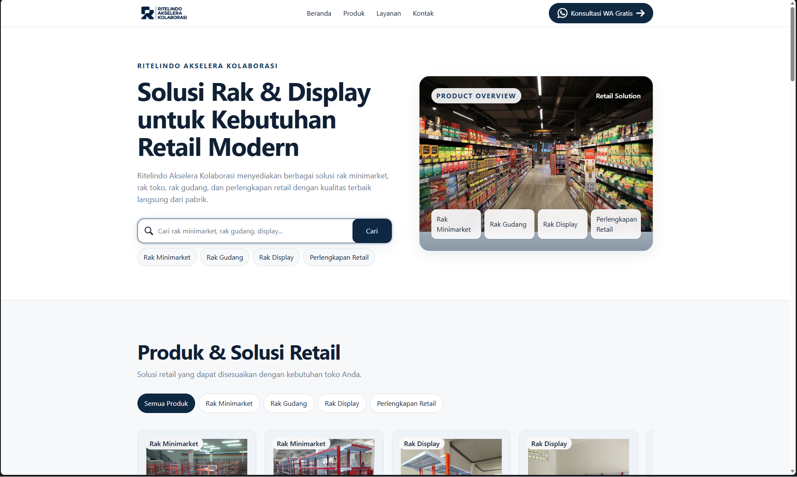
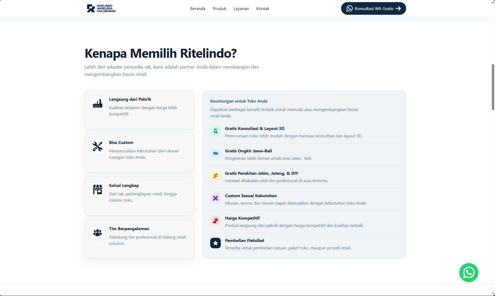
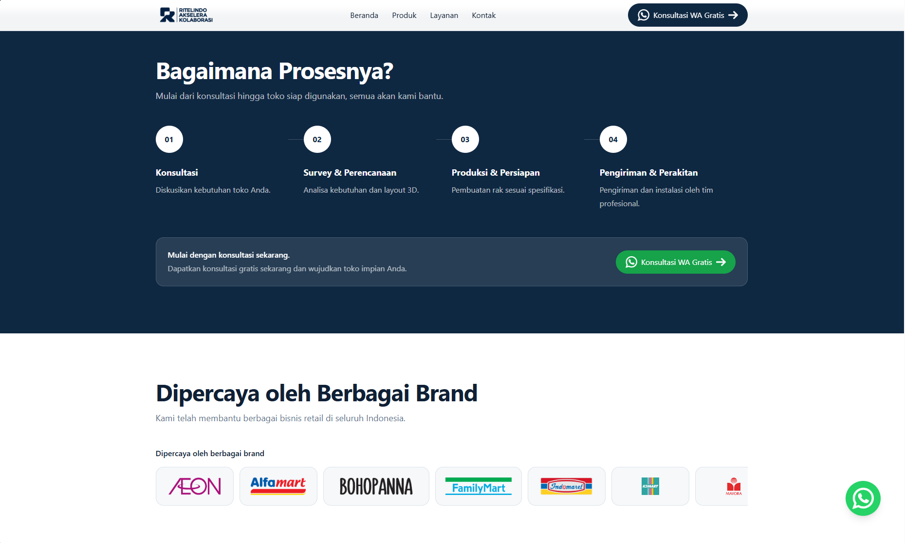
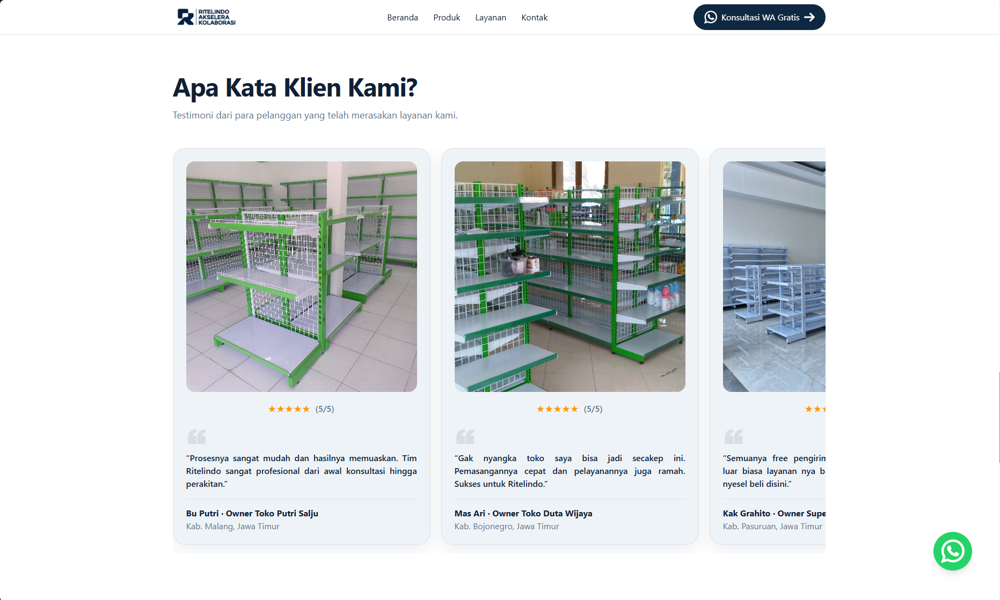

# 🏪 Ritelindo Mini Test --- Retail Store Landing Page

> A conversion-focused B2B landing page for **Ritelindo Akselera
> Kolaborasi**, built with **React**, **TypeScript**, **Vite**, and
> **Tailwind CSS** as part of the Web Developer Intern technical mini
> test.

------------------------------------------------------------------------

## 📸 Preview

The landing page is designed as a responsive single-page experience for
visitors coming from high-intent Google Search / Google Ads traffic.

**Live Demo:**\
https://kambing-gunung.github.io/ritelindo-mini-test/


|  |  |
|-----------|-----------|
|  |  |

------------------------------------------------------------------------

## 📖 About

Ritelindo Mini Test is a single-page B2B landing page created for the
**Ritelindo Akselera Kolaborasi** Web Developer Intern technical
assessment.

The landing page promotes solutions for **minimarket and retail store
setup**, including store racks, displays, customization, consultation,
layout planning, and interior services.

Rather than focusing only on visual presentation, this project
emphasizes **conversion-oriented UX**, **responsive design**, **semantic
HTML**, **SEO**, **performance**, and **clean component architecture**.

The primary conversion goal is to guide high-intent visitors toward:

> **Konsultasi WA Gratis**

------------------------------------------------------------------------

## 🎯 Why This Project?

This project was built to:

-   Practice modern React development
-   Build a conversion-focused landing page
-   Apply responsive and mobile-first design
-   Explore SEO-friendly single-page architecture
-   Practice clean and reusable component structure
-   Optimize the page for performance and usability
-   Apply real-world business and marketing requirements

------------------------------------------------------------------------

## 🔥 Highlights

-   B2B landing page focused on retail store solutions
-   Conversion-oriented content structure
-   Primary WhatsApp CTA throughout the page
-   Functional client-side product search
-   Responsive horizontal product and testimonial sections
-   Mobile-first responsive layout
-   Sticky WhatsApp action button
-   Semantic HTML structure
-   SEO metadata and Open Graph support
-   Lightweight static architecture
-   Reusable React components
-   Centralized site and contact configuration

------------------------------------------------------------------------

## ✨ Features

### Hero & Product Discovery

-   Main value proposition
-   Product/store visual
-   Product search
-   Popular product category shortcuts
-   Direct navigation to product section

### Product Showcase

-   Retail product cards
-   Product images
-   Client-side search and filtering
-   Horizontal product browsing
-   Responsive layout

### Why Ritelindo

-   Direct-from-factory positioning
-   Custom product capability
-   Complete retail solutions
-   Experienced team positioning

### Services

-   Consultation
-   3D store layout
-   Store racks and displays
-   Custom solutions
-   Store interior services

### How It Works

-   Consultation
-   Requirement / planning
-   Layout / customization
-   Setup / delivery / assembly
-   WhatsApp conversion CTA

### Trust & Proof

-   Customer testimonials
-   Customer ratings
-   Partner / brand logos
-   Social proof presentation

### FAQ

-   Custom rack questions
-   Consultation and 3D layout
-   Shipping
-   Assembly
-   Purchase options
-   Store interior services

### Conversion

-   Primary WhatsApp CTA
-   Prefilled WhatsApp message
-   Sticky WhatsApp button
-   Final conversion section

------------------------------------------------------------------------

## 🛠 Technology Stack

  Category          Technology
  ----------------- --------------
  Language          TypeScript
  UI Library        React
  Build Tool        Vite
  Styling           Tailwind CSS
  Code Quality      ESLint
  Deployment        GitHub Pages
  Version Control   Git / GitHub

------------------------------------------------------------------------

## 🏛 Architecture

The project follows a static single-page application architecture where
the browser loads the React application and local content/assets are
used to render the landing page.

``` text
┌─────────────────────────────┐
│          Browser            │
└──────────────┬──────────────┘
               │
               ▼
┌─────────────────────────────┐
│       React Application     │
└──────────────┬──────────────┘
               │
       ┌───────┴────────┐
       ▼                ▼
┌─────────────┐  ┌─────────────┐
│   Content   │  │   Assets    │
│    /Data    │  │ Images/Icons│
└──────┬──────┘  └─────────────┘
       │
       ▼
┌─────────────────────────────┐
│      Landing Page UI        │
└──────────────┬──────────────┘
               │
               ▼
┌─────────────────────────────┐
│          WhatsApp           │
│      Lead / Consultation    │
└─────────────────────────────┘
```

No backend, database, authentication, CMS, or server-side application is
required for the current mini-test scope.

------------------------------------------------------------------------

## 📂 Project Structure

``` text
ritelindo-mini-test
│
├── .github
│   └── workflows               # Deployment / CI configuration
│
├── docs
│   ├── image1.png
│   ├── image2.png
│   ├── image3.png
│   ├── image4.png
│   └── implementation-source-of-truth.md
│
├── public                      # Public static assets
│
├── src
│   ├── assets
│   │   ├── images             # Product, service, and visual assets
│   │   └── icons              # UI icons
│   │
│   ├── components
│   │   ├── layout              # Navbar, Footer, etc.
│   │   ├── sections            # Landing page sections
│   │   └── ui                  # Reusable UI components
│   │
│   ├── config                  # Site configuration
│   ├── data                    # Product and content data
│   ├── pages                   # Page-level components
│   ├── App.tsx
│   └── main.tsx
│
├── index.html
├── package.json
├── vite.config.ts
├── tsconfig.json
└── README.md
```
------------------------------------------------------------------------

## 💡 Engineering Practices

This project applies several software engineering and frontend
development concepts:

-   Component-Based Architecture
-   Reusable React Components
-   Separation of Concerns
-   Centralized Site Configuration
-   Semantic HTML
-   Mobile-First Responsive Design
-   Client-Side State Management
-   Client-Side Product Search
-   Accessibility Considerations
-   SEO-Friendly HTML Structure
-   Performance-Oriented Asset Loading
-   Clean and Maintainable Code

------------------------------------------------------------------------

## 🚀 Getting Started

### 📋 Requirements

-   Node.js 18+
-   npm
-   Git
-   Modern web browser

### 1. Clone Repository

``` bash
git clone https://github.com/Kambing-Gunung/ritelindo-mini-test.git
```

### 2. Open Project

``` bash
cd ritelindo-mini-test
```

### 3. Install Dependencies

``` bash
npm install
```

### 4. Run Development Server

``` bash
npm run dev
```

The application will be available at the local URL provided by Vite,
usually:

``` text
http://localhost:5173
```

### 5. Build for Production

``` bash
npm run build
```

### 6. Run Linter

``` bash
npm run lint
```

------------------------------------------------------------------------

## 🌐 Project Links

### GitHub Repository

https://github.com/Kambing-Gunung/ritelindo-mini-test

### Live Demo

https://kambing-gunung.github.io/ritelindo-mini-test/

------------------------------------------------------------------------

## 🗺️ Project Status

✅ Completed

The landing page was developed as a technical mini test for the **Web
Developer Intern** position at Ritelindo Akselera Kolaborasi.

The current implementation covers:

-   Landing page structure
-   Product discovery
-   Responsive UI
-   Conversion-focused CTA
-   WhatsApp integration
-   Trust and testimonial sections
-   FAQ
-   SEO baseline
-   Static deployment
-   Clean component architecture

------------------------------------------------------------------------

## 🚀 Future Improvements

-   Connect production WhatsApp number
-   Replace placeholder contact information with verified business data
-   Add analytics and conversion tracking
-   Further optimize image assets
-   Add structured data where appropriate
-   Improve Core Web Vitals based on real-user measurements
-   Add CMS or backend integration if future business requirements need
    dynamic content

------------------------------------------------------------------------

## 👨‍💻 Author

**Kambing Gunung**

-   GitHub: https://github.com/Kambing-Gunung

------------------------------------------------------------------------

## 📄 License

This project is developed for educational, technical assessment, and
portfolio purposes.
